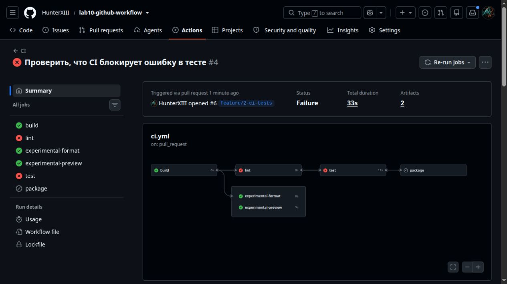
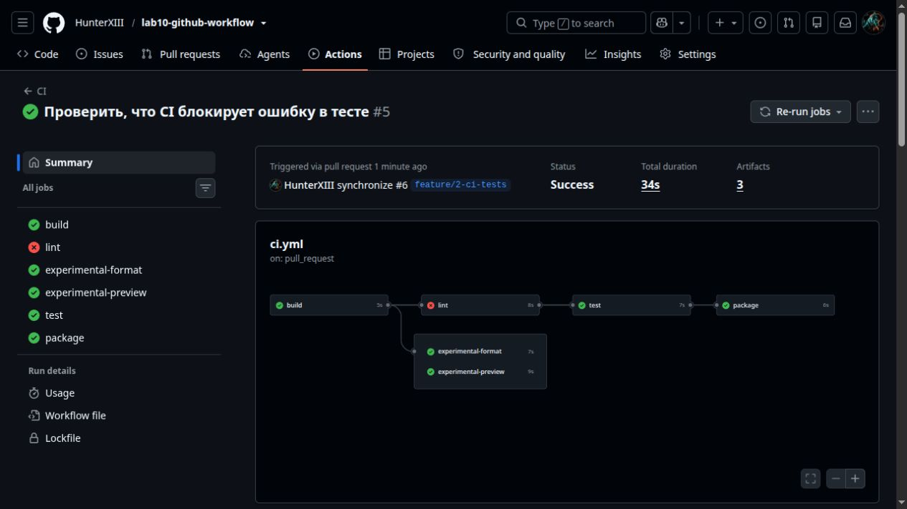

# Задание 2. CI для приложения

Настроил [CI](../.github/workflows/ci.yml) в GitHub Actions. Он запускается для PR в `main` и при push в `main` после слияния. У события `push` задан только фильтр ветки, поэтому теги workflow не запускают.

- `build` собирает `registration.pyz` с помощью `zipapp` и сохраняет его в артефакт `application`.
- `lint` запускает Ruff. Ошибки видны в GitHub, а `continue-on-error` позволяет запустить тесты.
- `test` запускает pytest с coverage. JUnit и coverage сохраняются в `test-reports`, даже если тест упал.
- `package` получает файлы из `build` и `test` и собирает `registration-package.tar.gz`.

Два экспериментальных задания проверяют форматирование и preview-правила Ruff. У обоих стоит `continue-on-error: true`. `setup-python` кэширует скачанные пакеты pip с ключом, зависящим от `requirements-ci.txt`.

Реализация и проверка в [PR #5](https://github.com/HunterXIII/lab10-github-workflow/pull/5) и [PR #6](https://github.com/HunterXIII/lab10-github-workflow/pull/6).

## Что получилось при запуске

В [первом прогоне](https://github.com/HunterXIII/lab10-github-workflow/actions/runs/42777472096) я намеренно ожидал `False` для валидного адреса с меткой. `test` упал, `package` пропущен, XML-отчёты сохранились.

В [повторном прогоне](https://github.com/HunterXIII/lab10-github-workflow/actions/runs/42777558315) исправил ожидание на `True`. Все 5 тестов прошли, покрытие строк `registration.py` составило 60%. Строгий Ruff снова показал ошибки из-за отсутствующих docstring, но тесты и упаковка прошли. В итоговом архиве проверил `registration.pyz`, `junit.xml` и `coverage.xml`.

## Как проверить

Открыть **Actions → CI**, выбрать запуск и посмотреть задания и артефакты. Собранный файл запускается командой `python3 registration.pyz`.

**Зачем нужен `needs`?** Он задаёт зависимости. Упаковка ждёт сборку и обязательные тесты.
